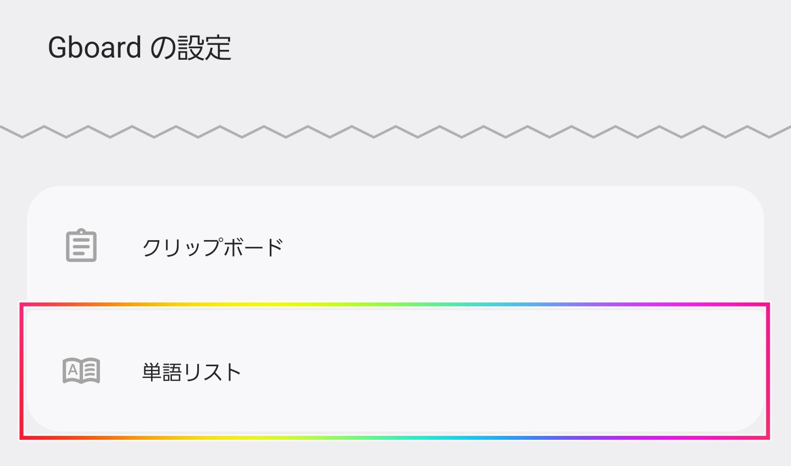
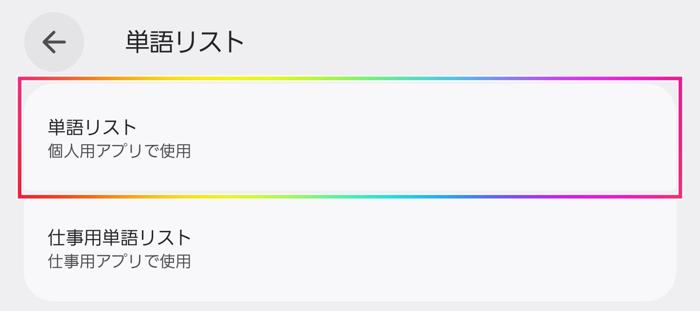
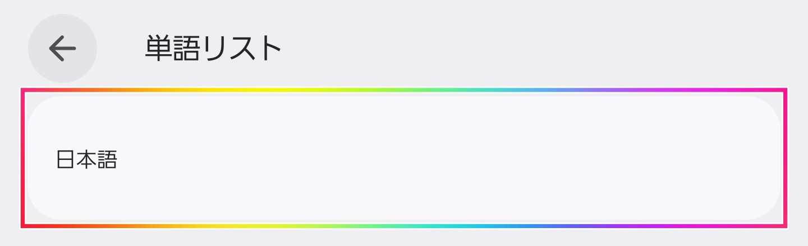
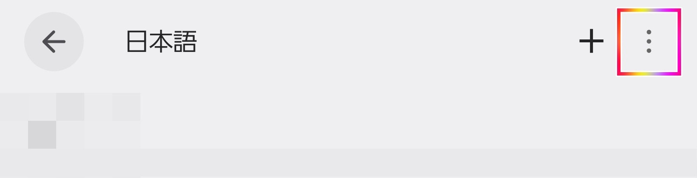
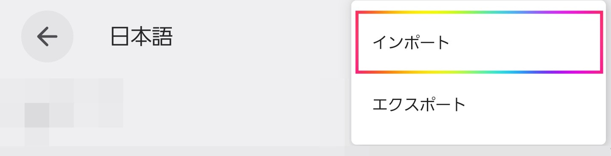

# mac-text-replacements-to-gboard

Macの「テキストの置換」（日本語の画面では「ユーザ辞書」）を書き出すスクリプトです。書き出した`dictionary.txt`は、Android版Gboardの単語リストに取り込めます。

対象はAndroid版のGboardだけです。iPhone版のGboardには、単語リストを取り込む機能がありません。

## 何をするか

- Macのユーザ辞書の実体（`~/Library/KeyboardServices/TextReplacements.db`）を読み取り専用で直接読みます。システム設定から一覧をドラッグして書き出す必要はありません。
- 全件をGboardの単語リストの形式で`dictionary.txt`に書き出します。
- Gboardへのインポートは手で行います。

## 動く条件

- macOS
- Python 3（3.15で確認）。標準ライブラリだけを使います。
- Android版のGboard

## 準備

1. このリポジトリをcloneし、そのフォルダに移ります。

```sh
git clone https://github.com/moyashimegane/mac-text-replacements-to-gboard.git
cd mac-text-replacements-to-gboard
```

2. 書き出し先のフォルダを作っておきます。スクリプトはフォルダを作りません。
3. `config.example`を`config`という名前でコピーします。

```sh
cp config.example config
```

4. `config`の`out=`に、書き出し先のフォルダを絶対パスで書きます。先頭の`~`はホームフォルダです。引用符や`\`は付けず、空白もそのまま書きます。

```text
out=~/Documents/gboard
```

書き出し先はどのフォルダでも構いません。Androidの端末に渡しやすいフォルダ（Googleドライブと同期しているフォルダなど）にしておくと楽です。`config`はgitで管理しません。

## 使い方

```sh
./mac_text_replacements_to_gboard.py
```

`config`の`out=`のフォルダに`dictionary.txt`を書き出します。同じ名前のファイルがあれば上書きします。

```text
341件を書き出しました: /Users/<ユーザー名>/Documents/gboard/dictionary.txt
```

一度だけ別のフォルダに書き出すときは`--out`を付けます。`config`より優先します。

```sh
./mac_text_replacements_to_gboard.py --out ~/Desktop
```

## 書き出す形式

Macのユーザ辞書がこうなっているとします。

| 読み | 語 |
|---|---|
| おせわ | お世話になっております。 |
| めあど | taro@example.com |

書き出す`dictionary.txt`はこうなります。区切りはタブです。

```text
# Gboard Dictionary version:2
# Gboard Dictionary format:shortcut	word	language_tag	pos_tag
おせわ	お世話になっております。	ja-JP	
めあど	taro@example.com	ja-JP	
```

- Gboard自身が書き出す単語リストと同じ形式です。
- 言語は`ja-JP`です。品詞の欄は空にします。品詞が空でも変換の候補に出ます。
- 文字コードはUTF-8（BOMなし）、改行はLFです。

## Gboardへのインポート

1. `dictionary.txt`をAndroidの端末に入れます（Googleドライブ、USBケーブルなど）。
2. Gboardの設定を開き、「単語リスト」を選びます。

   

3. 「単語リスト」を選びます。

   

4. 「日本語」を選びます。

   

5. 右上のメニューを開きます。

   

6. 「インポート」を選び、`dictionary.txt`を選びます。

   

Gboard 18.6.7（Android 17）で確認しました。

## 知っておくこと

- 毎回、全件を書き出します。同じ読みと語の組は何度インポートしてもGboardの中で二重になりません。そのため、全件をそのままインポートして構いません。
- インポートは追加だけです。Macで消した語や直す前の語は、Gboardに残ります。消したいときはGboardの単語リストで手で消します。
- iCloudでiPhoneのユーザ辞書と同期している場合は、iPhoneで足した語も入ります。
- 読みか語が空の語や、タブ・改行を含む語があるとエラーになります。このときは何も書き出しません。Macのユーザ辞書で直してから実行してください。
- 書き出し先のフォルダが無いとエラーになります。
- `TextReplacements.db`はAppleが公開している形式ではありません。macOS 27.2で確認しましたが、macOSの更新で変わる可能性があります。
- `dictionary.txt`の中身は自分の辞書そのものです。公開の場所に置かないでください。

## テスト

```sh
python3 -m unittest discover -s tests
```

## ライセンス

[MIT](./LICENSE)
